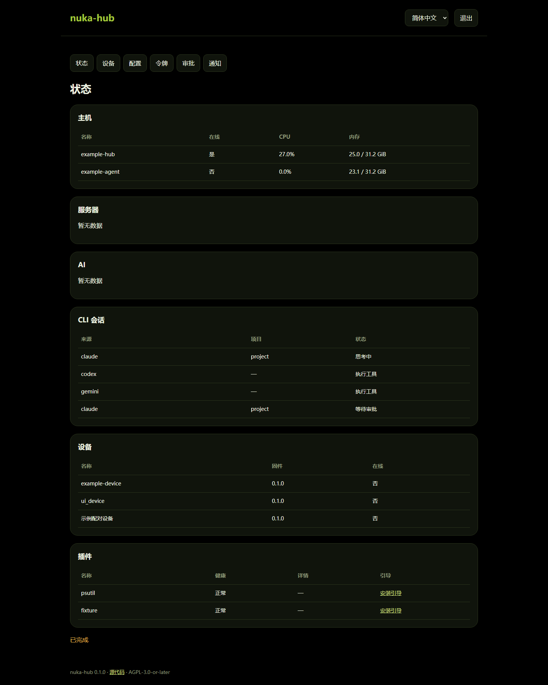
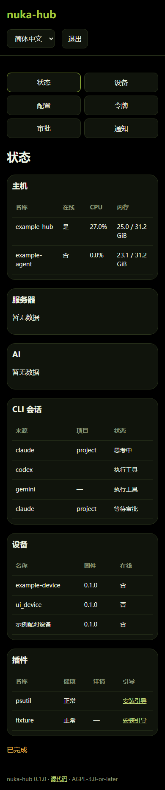
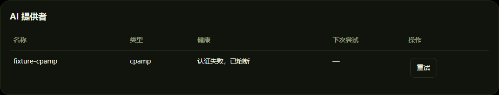

# BE M5 功能验收记录

日期：2026-10-18。环境：Windows、CPython 3.12.12、uv 0.9.28。Hub 使用正常运行模式；所有服务器、AI 和天气上游仅使用合成 fixture 或本地假服务。未连接真实 CPA / CPAMP、探针、天气 API；未修改真实 Claude、Codex 或 Gemini 配置。

| 任务卡 | 验收项 | 状态及证据 |
|---|---|---|
| HUB-08 | psutil、Host 聚合、三个平台 | Windows 通过，实际 Host 契约校验通过；macOS/Linux 实机跳过，环境不可用 |
| HUB-09 | NVML、AMD sysfs、Linux 传感器 | Windows NVML 实际采样通过；不适用平台明确 disabled。Linux AMD/传感器实机跳过 |
| HUB-10 | LHM、macmon、自定义 map | T3 fixture 与自定义规则通过；Windows LHM 本地 HTTP 假服务通过。Apple Silicon 实机跳过 |
| HUB-11 | Agent D2、断线 30 秒后离线 | 通过：本机两个进程产生 hub/agent 两台主机，Agent 断开后离线 |
| HUB-12 | serverstatus、generic_json、合并 | T3 与名称/别名聚合通过，本地 HTTP 假探针持续采样 |
| HUB-13 | 其余四种数据源 | 每种一个 T3 fixture 通过，本地假服务通过；上游形状版本见 [适配器记录](be-adapters.md) |
| HUB-14 | 三种推送、去重、勿扰、限流 | 通过：JSON、纯文本、GET 查询均 202；重复通知同 nid；10 次突发后第 11 次 429；电量告警仅进 Web |
| HUB-15 | 表达式、去抖、恢复、repeat | T4 通过；未知字段/恶意表达式案例按规范拒绝 |
| HUB-16 | L1/L2、401/403 熔断、白名单 | T2/T3 通过；首次认证错误立即发布 auth_failed，刷新不再请求；显式 retry 只增加一次 L1 |
| HUB-17 | 三种 L3 配方、最小间隔 | 每种一个 T3 fixture 通过，SafeClient 拒绝配方白名单外 URL；不访问真实上游 |
| HUB-18 | Claude 审批、hook 延迟 | T5 通过；真实本地 HTTP 30 次非审批 hook 最大值 3.04 ms；浏览器允许后 HTTP hook 收到审批结果 |
| HUB-19 | nuka-hook、Codex/Gemini 状态 | 最新实际转发三次各 0.375 秒，新 sid 均在 Buddy 可见；离线三次 0.781 / 0.797 / 0.750 秒。模拟本机 DNS 阻塞 4 秒时 1.156 秒退出；均退出 0、无输出。入口总截止避免 asyncio 关闭时等待 DNS 线程。能力评估见 [报告](codex-gemini-approval.md) |
| HUB-20 | 三种 hook 安装、备份、恢复 | 通过：全部在临时 home；卸载后三份配置逐字节等于原文件 |
| HUB-21 | 媒体、封面、控制 | Windows SMTC 实际读取及自建静音会话四种原生控制通过；合成封面 160×160 JPEG 2195 B，URL SHA-256 一致。macOS/Linux 实际播放控制跳过，缺少对应系统 |
| HUB-22 | 天气、宠物、时间 | T3 天气与十主题 T6 通过；本地天气 HTTP 假服务正常；mood 规则对应 SPEC 注释 |
| HUB-23 | USB/SoftAP 配对、错误五次失效 | 本地 WS pair.wait→pair.ok 和错误五次 4004 通过；真实 USB 配对等待 FW 联调 |
| HUB-24 | publish、offer、鉴权下载 | 通过：CLI 发布假镜像后在线模拟器收到 ota.offer，下载哈希一致；admin 下载 401，device 下载成功。主动 ota.check 同 ID 确认后按 manifest 路径顺序发更新，同版本跳过，允许回退，多项可选；独立 auto_offer，空清单也确认 |
| HUB-25 | REST 全部接口、分页、契约 | 功能接口已覆盖；十种列表分页通过，非法 limit 400；真实 Host/Server 结构校验通过，demo T6 通过 |
| HUB-26 | doctor、端口、防火墙、mDNS、LHM 提示 | 通过：运行 Hub 只读健康快照、临时 admin 立即撤销；端口归属准确；mDNS 独立进程查到服务且端口/proto/ws 正确；非管理员 LHM 提示存在。防火墙查询 10 秒超时如实标 degraded，无规则修改 |
| HUB-27 | 服务安装、状态、卸载、自启 | 三平台实现与双语引导已交付；Windows 安装被系统以 AccessDenied 拒绝，未创建任务；macOS/Linux 及实际登录/重启自启跳过，环境/权限不可用 |
| HUB-28 | public 判定、hooks 404、Access JWT | T1 通过，含回环 CF 头判为 public；uvicorn 禁用代理头自动重写。真实 cloudflared 跳过，以本地 CF 头替代 |
| HUB-29 | wheel、锁定依赖、Docker、三平台发布 CI | Windows 干净 venv 安装 wheel[all] 和 nuka init 通过；Docker 使用固定 uv 及 uv.lock。三平台 runner、镜像构建/发布待远程环境；未本机发布 |
| HUB-30 | Vault 导入导出、otpauth | CLI 代码就绪：本机 scrypt 固定参数，USB 只传派生密钥，密钥不落盘/日志；真实 USB 加密往返等待 FW-23，不能用代码检查代替验收 |
| HUB-31 | Web 全页操作、错误行号、public 隔离、移动端 | 浏览器实操通过：登录/退出、设备改名/删除、配置错误行 2/修复保存、密钥写入清空/只列名称/删除、令牌创建一次显示/撤销、审批、通知、配对和 OTA。桌面/手机截图如下 |

Web 使用原生模块、一份小 CSS 和生成的主题 CSS，每 5 秒轮询，默认中文、可切英文；页脚版本和源代码链接来自包元数据。配置/密钥/审批的 public 隔离由 T1 检查。





INT 发现的 BE-INT-001 已修复：状态页补齐 AI 提供者健康表；认证熔断时显示“重试”，正常或 public 区域不显示此操作。以真实正常 Hub 和本地假 CPAMP 在浏览器复测：错误占位密钥产生 auth_failed，5 秒轮询显示中文熔断状态和按钮；恢复正确占位密钥后点击现有按钮，实际 POST retry 返回 200，提供者为 ok 且按钮消失。密钥修改本身会重建提供者，因此按钮点击与密钥恢复在同一浏览器操作中完成；未把自动恢复误记为按钮独立恢复。测试钥匙串项已删除，文件中的正确占位值保留；维护者的管理员令牌和 Hub 进程未改动。



验证命令与结果：

```sh
hub/.venv/Scripts/python.exe -m pytest hub/tests/test_t1_zones.py hub/tests/test_t2_ai.py hub/tests/test_t3_adapters.py hub/tests/test_t4_alerts.py hub/tests/test_t5_approval.py -q
hub/.venv/Scripts/python.exe -m pytest hub/tests/test_t6_demo.py -q
ruff check hub
ruff format --check hub
python scripts/check_protocol.py
python scripts/check_no_personal.py
python scripts/check_license.py
```

最终统一运行 T1–T6：77 passed（64.46 秒）；T6 使用真实 TCP/WS 运行 60 秒，包含十种 VM 和审批往返。Ruff check 和 format --check 均通过（55 个源文件），Web JS 语法检查通过。补齐契约后的最新语料为 66 schemas / 137 payloads / 0 failures；SPDX 和个人值检查均无错误。T4 的无效表达式案例产生预期 warning。未新增 T1–T6 之外的测试。

收尾复核：12 个真实 TCP 坏帧案例按 1008 / 1009 / 4002 关闭；正常全插件 Hub 另抓 16 帧，经 T6 校验零错误。修复后 T6 重跑 1 passed（67.09 秒）。两台真实 WS 客户端分别取得中文/英文内置告警，内部翻译元数据不出现在 REST / WS；用户自定义标题按原文保留。勿扰和宠物深夜判断采用配置的 Hub 时区。USB CLI 新增的 info/chunk/import/配网输入边界模型通过六个契约样例检查，未把内部派生值重复校验。Docker 构建上下文排除本地虚拟环境、配置、密钥和 Vault 文件；本机没有 Docker/Podman，镜像执行验收交发布 runner。

首次契约补齐后，配网输入另验 12 个边界案例：SSID / 密码 UTF-8 字节长度、NUL、规范化后的 Hub URI 511 字节上限均通过；SSID 保留用户输入的首尾空格。OTA 主动检查另以真实正常 Hub 验证确认顺序、四个 offer、缺 ID 关闭 1008 和空清单，10 帧通过统一 schema；现有 60 秒 T6 纳入 ota.check 输入与同 ID 确认并通过（63.30 秒）。时间约束另验 15 个手工案例：2000–2099 的秒数范围、127 字节可打印 ASCII TZ、空串合法性及四个 IANA 时区转换均符合；异常本机时钟直接报错，无夹逼或默认时间。加入时间约束后，60 秒 T6 再次通过（63.30 秒）。

设备 JSON 禁 NUL 的 13 个手验通过：设备 WS 收发与 CDC 接收均拒绝 U+0000，包含 unknown 字段和嵌套对象 key；字面反斜线序列 `\u0000` 允许，Agent/REST/配置不扩大规则。全部设备 WS 输出（含 pair.wait / pair.ok）使用统一传输边界。媒体活动排序另验四场景：曲目或播放状态变更后移到首项；只更新进度 / at 不改活动时间；删除源清理排序记录。未增加协议字段。

E11 准备补齐 Windows 原生媒体控制：同机独立配置运行真实 Agent、psutil 和 Windows SMTC，只上报自建静音 Chromium MediaSession，过滤其他播放器。REST → Hub → Agent → SMTC → 自建播放器的暂停、播放、下一首和上一首均返回 200，状态采样分别在 1.000 / 1.031 / 1.172 / 1.172 秒确认；未用合成媒体适配器。该结果证明 Agent 路由和本机原生控制，物理设备的主机切换及媒体操作仍交 INT-01，不能据此判 E11 通过。独立配置、令牌和事件原件只存忽略的 build/bench-be/e11/。

安全复核补齐精确密钥重载：只重建引用该名称的插件，保留其他提供者的实例和熔断状态；删除所用密钥后提供者同步 disabled，不保留旧熔断按钮。既有 T2 加入 401 / 403 两个提供者隔离案例，另一个密钥重载后被熔断提供者请求计数仍为 1。该场景发现的 Scheduler 取消竞态已修复：直接用超时上下文等待事件，不再创建并手工取消子等待任务，热重载和关闭不会吞掉外层取消。最后的 T2 / T3 合并复测 27 passed（0.96 秒），仅使用合成 fixture。

NFR-4.5 Windows 本机一小时观察通过：连续运行 3602.27 秒，进程 RSS 最小 73.212 MB、最大 137.986 MB、终值 105.103 MB，均低于 150 MB。每 10 秒采样，含终点共 361 个记录，见 [RSS 原始数值](be-rss.csv)；单位为十进制 MB。

| 时刻 | 实际经过秒数 | RSS / MB |
|---|---:|---:|
| 启动 | 0.00 | 73.212 |
| 5 分钟 | 300.22 | 135.340 |
| 15 分钟 | 900.73 | 137.425 |
| 30 分钟 | 1801.33 | 137.740 |
| 45 分钟 | 2701.84 | 113.799 |
| 60 分钟 | 3602.27 | 105.103 |

六种服务器、CPA/CPAMP、LHM、天气都指向独立本地假服务进程；Hub 启用 psutil、NVML、SMTC、mDNS、告警、历史存储，结束时 13 个插件 ok，macmon、linux_sensors、amd_sysfs 因 Windows 平台不适用为 disabled。没有用此结果代替另外两个平台的测量。补充的 WS 模拟器和每 5 秒 REST 轮询曾重启客户端，故不声称全小时连续网络负载；后一次累计 3018 个 HTTP 请求、506 个服务器详情帧，Hub 本身在整段观察中没有重启。满一小时后 Hub 正常退出 0，WS 以 1012 关闭，负载客户端和独立假服务随之退出；已确认没有本次 RSS 进程残留，INT 假服务与维护者正常 Hub 保留。手工脚本和含运行配置的原始记录仅在忽略的 build/bench-be/，公开 CSV 只含经过时间和 RSS，不含部署地址、媒体标题或凭据。

已授权的契约补齐均由 C/root 记录在 DECISIONS 和 PROTOCOL；BE 未私自新增协议字段。当前需其他轨道配合的是 HUB-23/FW-16、HUB-30/FW-23，以及 INT-01 真设备功能复测。跨平台、服务权限和发布 runner 未验项如上，不能据此宣称 M5 全部验收完成。
