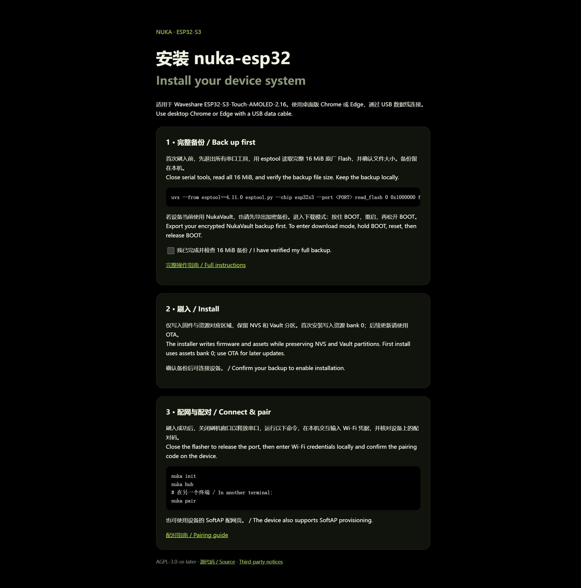

# 资源、国际化与安装产物验收

日期：2026-10-18。范围：FW-05、FW-27、FW-29，以及 HUB-29 的共享发布产物；功能验收进行中，未启动 FE。

| 任务卡 | 验收项 | 状态与证据 |
|---|---|---|
| FW-05 | 字体生成、中文子集、4bpp | 通过：FontTools 4.62.1、lv_font_conv 1.5.3；Inter 22/28/32/40/56、Nerd Font 数字 112/40、Noto Sans SC 22/28，共 9 份 NFN1 字体 |
| FW-05 | 字体许可 | 通过：源字体及完整 OFL 文本随仓库保存，许可证也纳入资源包；Nerd Font 只保留 Latin 字形，不使用混合许可的图标 |
| FW-05 | mmap、ABI、大小与版本 | 构建及源码检查通过：同一 loader 校验启动和 OTA bank 的 header、索引、SHA-256、字体及包内版本；完整包 2,321,558 B，小于单 bank 的 3 MiB；实际整机 OTA 待验 |
| FW-05 | en-only | 构建通过：7 字体、181,614 B；模拟器启动另见 SDL 报告 |
| FW-05 | 112 px 时钟、中英混排 | 诊断真屏通过：维护者确认时钟和 USB 配网文字可见；完整 App 的显示与操作另由 FW / SDL 记录 |
| FW-27 | 两语言键一致、生成文件同步 | 通过：245 个匹配键，`gen_strings.py --check` 通过；逐字符对照生成字体，零缺字；常用 3500 字加业务文案生成中文子集 |
| FW-27 | 设置切换语言立即生效 | 待验：真实设备设置操作；生成器通过不等于运行期验收 |
| FW-29 | 本地浏览器加载、备份门槛、安装清单 | 浏览器手验通过：备份确认前隐藏安装入口；清单五个区域与分区表一致；打包模块本地提供，不使用 CDN |
| FW-29 | 禁止整片擦除 | 通过构建检查与浏览器手验：固定版本 ESP Web Tools 的安装逻辑始终保持 `_installErase=false`，包括首次安装分支；不依赖清单提示开关保证此约束 |
| FW-29 | 浏览器连接实物并完成刷入 | 跳过：维护者选择自动 CLI 刷机，未用浏览器接管串口；CLI 五段写入由 FW 记录，不代替本项 |
| HUB-29 | wheel / sdist 与干净安装 | Windows 通过：`uv build` 产出两种包，干净 venv 安装 wheel[all] 后版本和 init 可用；wheel 含 Web 资源、入口和 AGPL 全文 |
| HUB-29 | 三平台 runner、Docker / PyPI / Release 发布 | 待远程环境：已编写 workflow，actionlint 通过；未运行远程发布，不宣称三平台安装或镜像构建通过 |

完整中文包 SHA-256：`dad333637c3eae7866086bc9fcc892ad4b99c559bf01b77a656a18d0073ba6a9`。英文包 SHA-256：`7cf60526d3029071017a915159760d1f8661e18a0d973096098bb41007fcb615`。两包 ABI 为 1、版本为 0.1.0；本轮补上 Vault PIN 提示所需的 U+2013 短横线，中文业务文案的新增字形已在子集中。构建产物仅在忽略的 build/ 中。

主题对比度：text/bg 18.55:1、text/surface 16.46:1、text_dim/bg 6.88:1、text_dim/surface 6.10:1，分别达到 7:1 / 4.5:1 要求。此检查属于 C-02 / T6，没有新增 UI 自动测试。

发布 workflow 在手动触发时只构建并保留 artifacts；发布事件才执行 PyPI、GHCR 和 Release 附件上传。GitHub owner 在源码中仍为 `<owner>`，运行时由仓库元数据替换；Web 页脚的源代码地址由安装包 project.urls.Source 提供。当前未发布远程版本。

安装引导包含源码构建、首次 Flash 备份、CLI / 可选浏览器刷机、Windows / macOS / Linux / Docker 安装及卸载。所有示例使用占位符，实际配置、备份、运行凭据和原始记录不入仓库。

后续配合：FW 完成整机语言切换、USB 和 OTA 验收；BE / 发布环境完成其余平台实际安装；INT 只在功能验收满足后关闭相应问题。没有在本报告中把缺少硬件或环境的项目标为通过。

